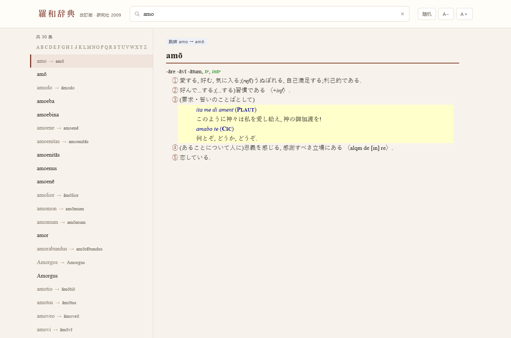

# 羅和辞典 · 网页版

把研究社《羅和辞典》（改訂版）的 MDict 词库转成一个**可以直接双击打开**的静态网页词典。

无需安装软件、无需联网、无需本地服务器 —— 双击 `index.html` 就能查词。



## 特性

- **即时联想**：输入词头边打边出结果，前缀匹配并按词典原序排列
- **长音符可省略**：`amo` 能查到 `amō`，`aetas` 能命中 `ætas`
- **u/v、i/j 通用**：前缀查不到时自动再试一次（`video` ↔ `uideo`）
- **和羅語彙集**：直接输假名或汉字，可查日语 → 拉丁语（如 `あい`）
- **交叉引用可点**：释义中带下划线的词点击即跳转，左侧列表同步定位
- **A–Z 字母栏**浏览、**随机**抽词、**A−/A＋** 调字号（字号本地记忆）
- **深链**：`index.html#am%C5%8D` 直接指向 `amō`，可收藏或分享
- **手机可用**：窄屏自动切单栏，带返回按钮
- **保留原书版式**：词性标绿、例句淡黄底、词头棕色横线，全部来自词典自带 `llj.css`

## 快速开始

**本地查看**：双击 `index.html`（Chrome / Edge / Safari / Firefox 均可）。

**本地起服务**（可选，行为和直接打开一致）：

```bash
python -m http.server 8000
# 然后访问 http://localhost:8000
```

**部署到 GitHub Pages**：仓库 Settings → Pages → Source 选 `main` 分支、目录选 `/ (root)`，稍等片刻即可通过
`https://<用户名>.github.io/<仓库名>/` 访问。

## 目录结构

```
.
├── index.html                页面入口
├── mdx/                      原始 MDict 词典（未改动）
│   ├── 羅和辞典.mdx          主词库 3.0 MB
│   ├── 羅和辞典.mdd          资源包（插图）89 KB
│   ├── llj.css               词典自带样式表
│   └── 羅和辞典.png          词典图标
├── data/
│   ├── idx.js                检索索引：词头 → 分片位置（2.36 MB）
│   ├── c0.js … c36.js        正文分片，按需加载（共 37 个）
│   └── stats.js              统计数字
├── img/                      从 .mdd 导出的 46 张插图
├── assets/
│   ├── app.js                检索、路由与渲染逻辑
│   ├── app.css               界面样式（正文仍用 llj.css）
│   ├── llj.css               词典原样式表
│   └── icon.png              图标
├── docs/screenshot.png       README 截图
└── tools/
    ├── build.py              mdx/mdd → 网页数据的转换脚本
    └── requirements.txt
```

## 数据来源

| 项 | 内容 |
| --- | --- |
| 书名 | 羅和辞典（改訂版） |
| 编者 | 水谷智洋 |
| 出版 | 研究社，2009 年 |
| 原文件 | `mdx/羅和辞典.mdx`、`mdx/羅和辞典.mdd`、`mdx/llj.css`、`mdx/羅和辞典.png` |
| 容器格式 | MDict 2.0（`GeneratedByEngineVersion="2.0"`），未加密 |
| 内文编码 | UTF-8，词条内容为 HTML 片段 |
| 规模 | 49,389 条词条 ＋ 32,960 条 `@@@LINK` 跳转词条，合计 **82,565 个检索项** |
| 正文体积 | 10.9 MB（HTML） |
| 插图 | 46 张，存放于 `.mdd` 的 `img/` 目录 |

**转换过程做了什么**

1. 解析 `.mdx` 的键块与记录块，按原顺序取出全部词头与释义；
2. 移除每条释义开头重复的 `<link href="llj.css">`（样式表改为全局加载一次）；
3. 把 `@@@LINK=` 跳转解析成指向目标词条的索引项；
4. 按折叠后首字母分组，正文切成 37 个约 600 KB 的分片；
5. 从 `.mdd` 导出全部资源到 `img/`。

词条正文的 HTML、原书样式表与插图**均未作内容改动**；交叉引用链接在浏览器端由 `assets/app.js` 改写为前端跳转。

## 重新生成数据

修改样式或想换一份词库时，可自行重建：

```bash
pip install -r tools/requirements.txt

python tools/build.py \
  --mdx   "mdx/羅和辞典.mdx" \
  --mdd   "mdx/羅和辞典.mdd" \
  --css   "mdx/llj.css" \
  --icon  "mdx/羅和辞典.png" \
  --out   . \
  --force
```

脚本会重写 `data/`、`img/`、`assets/llj.css`、`assets/icon.png`，不会碰 `index.html`、`assets/app.js`、`assets/app.css`。
同一份词库重复执行，产物字节级一致。

## 实现说明

- 浏览器不能直接读 `.mdx`（二进制 ＋ zlib 压缩块），所以采用**离线预编译**：把词库拆成索引 ＋ 分片，浏览器只做检索和渲染。
- 数据通过 `<script src>` 动态载入而非 `fetch`，因此 `file://` 双击打开也能正常工作（`fetch` 会被同源策略拦住，脚本标签不会）。
- 索引 82,565 行在启动时建一次折叠表（约 180 ms），之后每次输入直接线性前缀匹配，无感延迟。
- 检索折叠规则（去长音符、`æ→ae`、`œ→oe`、忽略大小写）在 `tools/build.py` 与 `assets/app.js` 中各有一份，改动时需同步。

## 已知限制

- 仅适配 MDict **2.0 / 未加密**词典，1.2 版或加密词库需要另外处理；
- 不做词形还原，`amo` / `amās` / `amāvī` 需分别检索（词条内的变化表可作参考）；
- 不支持全文检索释义内容，只能搜词头；
- 首次打开需读取 2.36 MB 索引，机械硬盘或老设备上可能多等一会儿。

## 版权与免责

词典正文、插图及其版式（`mdx/`、`data/`、`img/`、`assets/llj.css`）的著作权归 **研究社及编者** 所有。
本仓库仅为**个人学习与检索**提供格式转换，请勿用于商业用途或再分发。若权利人认为不妥，请联系删除。

本仓库的程序部分（`index.html`、`assets/app.js`、`assets/app.css`、`tools/build.py`）可自由使用、修改。
